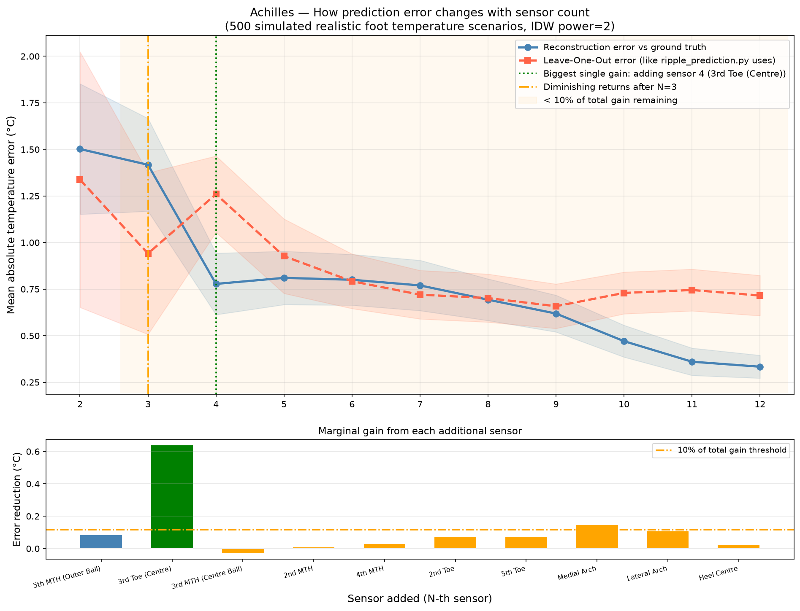

# Foot Thermal Mapping

Python software that turns a small number of thermistor readings from a wearable insole into a live temperature map of the forefoot, and a simulation study of how many sensors such a map needs.

## Problem

Localised rises in plantar (sole-of-foot) temperature can be an early sign of inflammation, which is why temperature monitoring is studied for diabetic foot ulcer prevention. An insole can only carry a limited number of sensors, so the temperature between sensors has to be estimated. This project explores how to do that estimation, how accurate it is, and where sensors should go.

## Project context

This was built as part of a team internship project on a thermistor insole. Arnav developed the Python analysis, prediction, visualization, and sensor-optimization software included in this repository.

Not included here:

- **Arduino firmware.** The scripts read data from a 16-channel thermistor firmware written by a teammate (Tan Zi Yi). It is not published in this repository. See [Data format](#data-format) for what the scripts expect from it.
- **Insole hardware.** It was developed by the project team.

## Hardware used

- Arduino GIGA R1 (12-bit ADC)
- 16 × 10 kΩ NTC thermistors, Vishay NTC-A Flex ([datasheet](https://www.vishay.com/docs/29132/ntcaflex05.pdf)), each in a voltage divider with a 10 kΩ resistor
- 2 × 8-channel analog multiplexers (MUX1 → T1–T8, MUX2 → T9–T16)

## Data format

The firmware sends one line every ~0.5 s over USB serial at **115200 baud**: 16 comma-separated temperatures in °C (`T1,T2,…,T16`), with `NaN` for a channel that cannot be read. Every script auto-detects the Arduino's COM port and ignores any line that does not have exactly 16 values. When a channel reads `NaN`:

- `launch_monitor.py` displays it as `NaN`
- `ripple_prediction.py` and `Temperature_Prediction.py` skip that frame and show which channel is missing

## Scripts

| File | What it does |
|---|---|
| `launch_monitor.py` | Live terminal monitor of all 16 channels: temperature, a bar-graph level and the change since the previous reading. When run from an IDE it opens its own PowerShell window. |
| `linear_prediction.py` | 1D linear interpolation along a strip of sensors (positions set in `SENSOR_POSITIONS`, currently 38, 48 and 70 mm from the big-toe reference). Shows 9 evenly spaced estimates per segment. |
| `ripple_prediction.py` | 2D Inverse Distance Weighting (IDW) map of the forefoot. Shows a 3-sensor layout and a 4-sensor layout side by side, with live Leave-One-Out error (mean, worst case and RMS over 30 frames) for each, to measure how much the 4th sensor reduces the residual error. |
| `Temperature_Prediction.py` | 2D Radial Basis Function (thin-plate spline) map of the right forefoot from 4 sensors (T1–T4), with an auto-scaled display and live Leave-One-Out error. |
| `sensor_optimiser.py` | Offline Monte Carlo simulation of how IDW map error changes as sensors are added, from 2 to 8. Saves `sensor_optimization_graph.png`. |

The live maps are drawn as ASCII text in the terminal and redrawn each frame. Coordinates are in millimetres on the forefoot: X = 0 is the big-toe (inner) edge and X = 89 the outer edge. Y = 0 is the ball of the foot and Y = 100 the toe tips.

The early thermal maps used a fixed set of ASCII symbols across a 20–36 °C range, which made sub-degree skin-temperature changes difficult to distinguish. We briefly tested color-coded cells for finer visual separation, but ultimately returned to symbols. In the final RBF tool, the symbol scale dynamically stretches across the current sensor readings, with a minimum 2 °C span, so small local changes remain visible in real time.

## How it works

The prototype initially used 16 thermistors across both feet. To reduce hardware, we cut the design to eight thermistors—four per foot—while preserving the ability to reconstruct useful spatial temperature patterns. We then evaluated the four-sensor layout more closely: adding the fourth sensor reduced simulated reconstruction error by 45%, while a simulated 3-vs-4 Leave-One-Out comparison showed that the fourth sensor covered a region the other three sensors predicted poorly. The current RBF tool in this repository maps one foot using T1–T4.

The project went through four approaches, each addressing a limitation of the one before.

1. **Linear interpolation (1D).** Assumes temperature changes in a straight line between neighbouring sensors along a strip. It is simple, but cannot map the foot as a surface.

2. **Inverse Distance Weighting (2D).** Each point on the map is a weighted average of all sensors, with weight 1/distance². The map is clipped to a forefoot-shaped outline. Its weaknesses:
   - circular "halo" artefacts around each sensor
   - it can never predict a value outside the range of the sensor readings

3. **Sensor-count simulation.** Generates 500 random plantar temperature fields, each a base temperature plus Gaussian warm and cool zones at anatomical sites. For each sensor count it:
   - samples each field at the sensor positions, with added noise
   - rebuilds the field with IDW
   - measures both the true reconstruction error and the Leave-One-Out error

   Sensors are added in a fixed clinical priority order. The random seed is fixed, so the results are reproducible.

4. **RBF thin-plate spline (2D).** Fits one smooth surface that passes through all four readings. It avoids IDW's halos. With only 4 sensors, the spline's linear trend made it overshoot in areas far from any sensor, showing hot or cold zones that were not real. To prevent this, predictions are clipped to the measured range.

**Leave-One-Out (LOO) error** is used throughout as a live accuracy check that needs no extra hardware. Each sensor is predicted from the others using the same method, and the mean absolute difference is reported.

## Sensor layout

`Temperature_Prediction.py` uses S1–S4. `ripple_prediction.py` compares S1–S3 against S1–S4.

| Sensor | Channel | Location | Position (X, Y) mm |
|---|---|---|---|
| S1 | T1 | 1st metatarsal head (inner ball) | (8, 8) |
| S2 | T2 | Hallux (big toe) | (5, 93) |
| S3 | T3 | 5th metatarsal head (outer ball) | (72, 8) |
| S4 | T4 | 3rd toe centre | (38, 55) |

The simulation adds four more candidate positions after S4, in this order: the 3rd, 2nd and 4th metatarsal heads, then the 2nd toe. Their coordinates are listed in `sensor_optimiser.py`.

## Simulation results

These are the output of `sensor_optimiser.py` (500 simulated fields per sensor count, IDW reconstruction).



| Sensors | Sensor added | Reconstruction error | LOO error |
|:-:|---|:-:|:-:|
| 2 | 1st MTH + Hallux | 1.502 °C | 1.338 °C |
| 3 | 5th MTH | 1.418 °C | 0.941 °C |
| 4 | 3rd toe centre | 0.778 °C | 1.260 °C |
| 5 | 3rd MTH | 0.810 °C | 0.927 °C |
| 6 | 2nd MTH | 0.800 °C | 0.792 °C |
| 7 | 4th MTH | 0.770 °C | 0.720 °C |
| 8 | 2nd toe | 0.693 °C | 0.702 °C |

Observations:

- **The 4th sensor (3rd toe centre) gives the largest single improvement.** It cuts reconstruction error by 45%, because it fills the biggest uncovered area in the middle of the forefoot.
- **A 5th sensor next to the existing ones at the ball slightly increases the error**, because it adds no new coverage.
- **Lower LOO error does not always mean a more accurate map.** Going from 3 to 4 sensors, LOO error rises from 0.941 °C to 1.260 °C even though the true reconstruction error falls. The 4th sensor sits in the centre of the forefoot, where the other three predict it poorly, and that same gap is why it improves the map.

These results come from a simulated temperature model, not from measurements on real feet.

## Running it

Requirements: Python 3 with `pyserial`, `numpy`, `scipy` and `matplotlib`.

```
pip install pyserial numpy scipy matplotlib
```

With the insole's Arduino connected and running the 16-channel firmware, run one of:

```
python launch_monitor.py          # raw 16-channel monitor
python linear_prediction.py       # 1D strip interpolation
python ripple_prediction.py       # IDW map, 3 vs 4 sensors
python Temperature_Prediction.py  # RBF map, right foot
```

Notes:

- Run one script at a time and stop it with **Ctrl+C**, because only one program can hold the serial port.
- Close the Arduino IDE Serial Monitor first.
- The live display uses ANSI terminal codes and was used on Windows (PowerShell).

The simulation needs no hardware:

```
python sensor_optimiser.py
```
